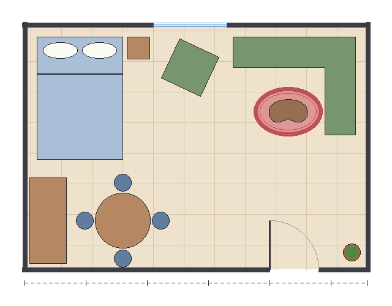
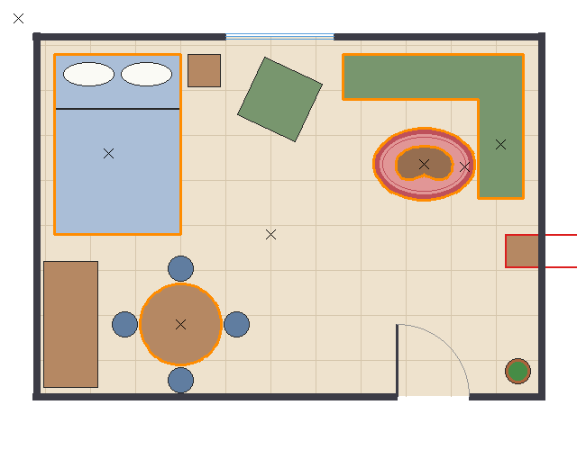
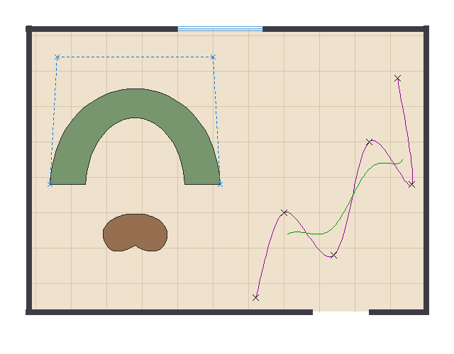

# RoomCraft

**RoomCraft** is a 2D-to-3D interior layout visualiser. Users lay out a room and
its furniture on a top-down 2D grid and will later view the result in 3D.

This repository contains **Checkpoint 1 – Technical Foundation**: a software
rasteriser written from scratch in **pure C++17 with only the standard
library**. There is no OpenGL, GLFW, ImGui or other graphics library. Every pixel is
written by our own algorithms through a single function, `Canvas::setPixel`,
and saved as an image file. The techniques are applied to RoomCraft objects:
walls, the editor grid, furniture footprints, round tables, rugs, door swings
and curved furniture.



*The complete floor plan written by `roomcraft_demo` (1 pixel = 1 cm, room 5.6 m × 4.0 m).*

---

## Group members and responsibilities

| Name | GitHub | Responsibilities |
|---|---|---|
| [Member 1 name] | [@github-username] | [e.g. lines and line clipping] |
| [Member 2 name] | [@github-username] | [e.g. polygons, clipping and filling] |
| [Member 3 name] | [@github-username] | [e.g. circles, ellipses and arcs] |
| [Member 4 name] | [@github-username] | [e.g. curves, demo and documentation] |

*Fill in the real names, usernames and responsibilities, and add or remove rows as needed.*

---

## Technologies and tools

| | |
|---|---|
| Language | C++17 (standard library only) |
| Build system | CMake ≥ 3.20 |
| Tests | CTest, with a small assertion helper ([tests/test_helpers.h](tests/test_helpers.h)) |
| Output | Binary PPM (P6) and 24-bit BMP, written by our own code |
| Tested with | GCC 15.2 (MSYS2 UCRT64) + Ninja on Windows 11 |
| Version control | Git / GitHub |

---

## Graphics techniques implemented

All coordinates are **screen coordinates**: the origin is the top-left corner,
x grows to the right and **y grows downward**. Integer coordinates are pixel
centres. Because y points down, positive angles turn **clockwise** on screen.
See [src/raster/types.h](src/raster/types.h).

| Technique | Algorithm | Source file | RoomCraft use |
|---|---|---|---|
| Line drawing | DDA | [line.cpp](src/raster/line.cpp) | Comparison with Bresenham |
| Line drawing | Bresenham / midpoint, integer-only, all 8 octants | [line.cpp](src/raster/line.cpp) | Every outline, grid line and wall |
| Line operations | Thick lines (perpendicular width), dashed lines, polylines | [line.cpp](src/raster/line.cpp) | Walls, dimension lines, furniture outlines |
| Line clipping | Cohen–Sutherland (region codes) | [line.cpp](src/raster/line.cpp) | Editor grid clipped to the room |
| Polygon representation | Ordered vertex list | [polygon.h](src/raster/polygon.h) | Furniture footprints, room outline |
| Polygon operations | Translate, rotate and scale about a pivot | [polygon.cpp](src/raster/polygon.cpp) | Moving, turning and resizing furniture |
| Polygon measurements | Shoelace area, area centroid, bounding box | [polygon.cpp](src/raster/polygon.cpp) | Floor-space statistics, selection boxes |
| Point in polygon | Even-odd ray casting | [polygon.cpp](src/raster/polygon.cpp) | Which piece of furniture was clicked |
| Polygon clipping | Sutherland–Hodgman | [clipping.cpp](src/raster/clipping.cpp) | Does the furniture fit inside the room? |
| Polygon filling | Scanline fill with an edge table and active edge table (even-odd, half-open rule) | [fill.cpp](src/raster/fill.cpp) | Solid furniture and floor; tiles without gaps or overlaps |
| Region filling | Boundary fill, 4-connected, explicit stack | [fill.cpp](src/raster/fill.cpp) | "Paint bucket" for floor zones |
| Circles | Midpoint circle with 8-way symmetry; filled disc | [circle.cpp](src/raster/circle.cpp) | Round tables, chairs, plant pots |
| Arcs | Midpoint circle limited to an angle range | [circle.cpp](src/raster/circle.cpp) | Door swings |
| Ellipses | Two-region midpoint ellipse with 4-way symmetry; filled ellipse | [ellipse.cpp](src/raster/ellipse.cpp) | Rugs, pillows |
| Bézier curves | Cubic Bézier: Bernstein form **and** de Casteljau | [curves.cpp](src/raster/curves.cpp) | Curved sofa, kidney-shaped coffee table |
| Splines | Catmull–Rom (passes through every point) | [curves.cpp](src/raster/curves.cpp) | Curtain track through clicked points |
| Splines (extra) | Uniform cubic B-spline (approximating) | [curves.cpp](src/raster/curves.cpp) | Smooth rounded outlines |
| Editor logic | `hitTest`, `findFurnitureAt`, `fitsInRoom` | [furniture.cpp](src/roomcraft/furniture.cpp) | Selecting furniture, flagging furniture that sticks through a wall |

Every algorithm is commented in its source file: what it does, why it works,
and how it fits the coordinate convention.

### Notes for the assessment

- **Bresenham** uses only integer additions and comparisons. One decision
  variable, derived in the comments, covers all eight octants using step
  directions `sx` and `sy`.
- **The scanline fill** recomputes each edge's x from the line equation on
  every row, instead of adding 1/slope each time as in the textbook version.
  Repeated float additions drift, and where an edge passes exactly through a
  pixel centre the drift can move a pixel by one. That would break the
  guarantee that neighbouring polygons neither overlap nor leave gaps, which
  the tests check.
- **The midpoint ellipse** traces region 1 from the top tip and region 2 from
  the side tip, splitting them at the slope = −1 point. The usual single-pass
  textbook loop put pixels up to a whole pixel off the curve on small or flat
  ellipses: 21–128 of the 3,600 sizes from 1×1 to 60×60, depending on the
  region-switch rule. The two-tip version keeps every pixel within half a
  pixel, with no gaps, for all 22,500 sizes from 1×1 to 150×150. Both
  versions use the same midpoint test, so the idea is unchanged.

---

## Project structure

```
roomcraft/
├── CMakeLists.txt
├── src/
│   ├── raster/              # the rasteriser (library "raster")
│   │   ├── types.h          # Point, Color, Rect, coordinate convention
│   │   ├── canvas.*         # pixel buffer, PPM and BMP export
│   │   ├── line.*           # DDA, Bresenham, thick/dashed lines, Cohen–Sutherland
│   │   ├── polygon.*        # transforms, area, centroid, point-in-polygon
│   │   ├── clipping.*       # Sutherland–Hodgman
│   │   ├── fill.*           # scanline fill, boundary fill
│   │   ├── circle.*         # midpoint circle, filled circle, arcs
│   │   ├── ellipse.*        # midpoint ellipse, filled ellipse
│   │   └── curves.*         # Bézier, Catmull–Rom, B-spline
│   └── roomcraft/
│       └── furniture.*      # Furniture, hitTest, findFurnitureAt, fitsInRoom
├── demo/
│   └── roomcraft_demo.cpp   # writes one image per technique + a floor plan
├── tests/                   # one test program per module (CTest)
│   ├── test_helpers.h
│   ├── test_*.cpp
│   └── output/              # images written by the tests (git-ignored)
├── demo_output/             # images written by the demo (git-ignored)
└── docs/images/             # PNG copies of demo images used in this README
```

---

## How to compile and run

The build produces the `raster` and `roomcraft` libraries, seven test programs
and the `roomcraft_demo` executable.

### Windows – MSYS2 / MinGW (the setup we tested)

Install [MSYS2](https://www.msys2.org/), then in an MSYS2 UCRT64 shell install
the tools:

```sh
pacman -S mingw-w64-ucrt-x86_64-gcc mingw-w64-ucrt-x86_64-cmake mingw-w64-ucrt-x86_64-ninja
```

Then, in PowerShell from the project folder:

```powershell
$env:PATH = "C:\msys64\ucrt64\bin;$env:PATH"   # once per terminal
cmake -S . -B build -G Ninja                    # configure (once)
cmake --build build                             # build
ctest --test-dir build --output-on-failure      # run all tests
.\build\roomcraft_demo.exe                      # write the demo images
```

### Windows – Visual Studio 2022

The **"Desktop development with C++"** workload must be installed (Visual
Studio Installer → Modify).

- **From the IDE:** *File → Open → Folder…* and pick the project folder.
  Visual Studio detects `CMakeLists.txt`. Build with *Build → Build All*, run
  the tests from the *Test Explorer*, and choose `roomcraft_demo.exe` as the
  startup item to run the demo.
- **From a "Developer PowerShell for VS 2022":**

  ```powershell
  cmake -S . -B build-vs -G "Visual Studio 17 2022"
  cmake --build build-vs --config Release
  ctest --test-dir build-vs -C Release --output-on-failure
  .\build-vs\Release\roomcraft_demo.exe
  ```

> We have not been able to test the MSVC build yet, so `/W4` warnings have not
> been checked. Please report any warnings.

### Linux / macOS

You need a C++17 compiler (GCC or Clang) and CMake ≥ 3.20.

```sh
cmake -S . -B build
cmake --build build
ctest --test-dir build --output-on-failure
./build/roomcraft_demo
```

> Not yet tested on Linux or macOS. The code uses only standard C++17.

### Running a single test

```sh
ctest --test-dir build -R test_line   # or run ./build/test_line directly
```

Each test prints a summary such as `test_line: 71144 checks, 0 failed` and
exits with a non-zero code if any check fails.

---

## How to view the output images

| Program | Writes to | Files |
|---|---|---|
| `roomcraft_demo` | `demo_output/` (or a folder given as the first argument) | `01_lines` … `07_selection`, each as `.bmp` and `.ppm` |
| `test_*` | `tests/output/` | one image per test, `.bmp` and `.ppm` |

- **`.bmp`** opens directly in Windows Photos, macOS Preview and most image
  viewers.
- **`.ppm`** is the simplest image format (a short text header followed by raw
  RGB bytes). Windows cannot open it without extra software; use GIMP or
  IrfanView, or an image viewer on Linux.

The demo also prints the area of each piece of furniture, a fit check and the
result of each simulated click to the terminal.

| Demo image | Shows |
|---|---|
| `01_lines` | Thick walls with door and window gaps, grid clipped to the room, dashed dimension line, DDA vs Bresenham, a polyline |
| `02_polygons` | Armchair translated, rotated and scaled about its centroid, with bounding boxes; L-shaped sofa whose centroid lies outside it |
| `03_clipping_filling` | Furniture pushed through walls and clipped to the room, floor tiles with no gaps, boundary-filled play mat |
| `04_circles_ellipses` | Round dining table and chairs, oval rug, pillows, plant pots, door swings |
| `05_curves` | Bézier sofa with its control polygon, kidney coffee table, Catmull–Rom vs B-spline curtain track |
| `06_floor_plan` | The complete room |
| `07_selection` | Simulated clicks (orange = selected piece) and a bookshelf sticking through the wall (red) |



*`07_selection`: clicks (✕) select the topmost piece under the cursor;
`fitsInRoom` flags the bookshelf pushed through the right wall.*



*`05_curves`: a Bézier sofa with its dashed control polygon, a kidney table made
of three Bézier curves, a Catmull–Rom spline (purple) passing through every
clicked point ✕, and a B-spline (green) that smooths past them.*

The README images are PNG copies of the demo's BMP files, converted with
Windows' built-in image tools so that GitHub can display them. The program
itself writes only BMP and PPM.

---

## Testing

Every test checks real properties, not just that the code runs:

| Test | Checks | What it verifies |
|---|---|---|
| `test_canvas` | 31 | Sizes ≤ 0 rejected; out-of-bounds pixels; PPM and BMP bytes read back |
| `test_line` | 71,144 | Bresenham and DDA in all 961 directions with \|dx\|, \|dy\| ≤ 15: both endpoints, no gaps, one pixel per step, within ½ pixel of the ideal line; 16 Cohen–Sutherland cases; thick, dashed and polyline helpers |
| `test_polygon` | 55 | Exact area 11250 and centroid (125, 100) of a known triangle; transformations; bounding box; point-in-polygon on concave shapes and vertex tie cases |
| `test_clipping_fill` | 58 | Clipped square has the expected 4 vertices; clipped triangle has 5; filled rectangle has exactly w×h pixels; hexagon split into 6 triangles has 0 overlaps and 0 gaps; boundary fill handles a 1000×1000 area and leaks through a gap as expected |
| `test_circle_ellipse` | 2,415 | Every circle radius 1–60 and ellipse 1×1–16×16: within ½ pixel, symmetric, no gaps; filled pixel count ≈ πr²; fill = outline + inside; arc ranges |
| `test_curves` | 76 | Bézier end points exact; Bernstein = de Casteljau at 1,001 values of t; Catmull–Rom passes through every point with matching tangents at joints; B-spline properties |
| `test_furniture` | 27 | Hit tests (including the inner corner of a concave sofa), topmost piece wins, `fitsInRoom` cases |
| `roomcraft_demo` | – | The demo runs and writes all 7 images |

---

## Current progress

**Checkpoint 1 – Technical Foundation: complete.**

- [x] Line drawing and line operations
- [x] Polygon representation and operations
- [x] Polygon clipping and filling
- [x] Circle and ellipse representation
- [x] Curves: Bézier curves and splines
- [x] Techniques applied to RoomCraft objects (demo floor plan)
- [x] Tests with real assertions, run by CTest
- [x] GitHub repository with source, README and commit history

**Planned for later checkpoints:** interactive 2D editor, 3D view of the layout.

---

## Known limitations

- **Sutherland–Hodgman needs a convex clip window.** `fitsInRoom` therefore
  only works for convex rooms, such as rectangles. L-shaped rooms are not
  supported yet.
- **Concave furniture clipped into separate pieces** comes back as one polygon
  with zero-width "bridge" edges along the wall. Its area and fill are
  correct, but its outline shows the bridges.
- **No anti-aliasing:** lines and edges are aliased ("jaggies").
- **Boundary fill needs a closed boundary.** A one-pixel gap lets the fill leak
  out, possibly over the whole canvas. It is 4-connected on purpose, so it
  does not leak through diagonal Bresenham walls.
- **Thick lines** have square-cut ends and no corner joins, so thick polylines
  show small notches at the corners.
- **Curves are drawn as polylines** with a fixed number of samples (no
  adaptive subdivision). Too few samples look angular.
- **The uniform B-spline does not reach its first and last control points.**
  That is a property of this spline type; it was not clamped.
- **Ellipses are axis-aligned only.** Rotated ellipses are not supported.
- **Round furniture** uses a many-sided polygon footprint for hit testing and
  fit checks, while it is drawn with the exact midpoint circle.
- **No text.** Labels and measurements are printed to the terminal, not drawn
  in the images.
- **No interactive editor yet:** clicks in the demo are simulated.
- **Images are BMP/PPM only.** The PNG images in this README were converted
  with external tools.
- **Platform testing:** only tested with GCC 15.2 on Windows. MSVC (`/W4`),
  Clang, Linux and macOS builds are untested.
