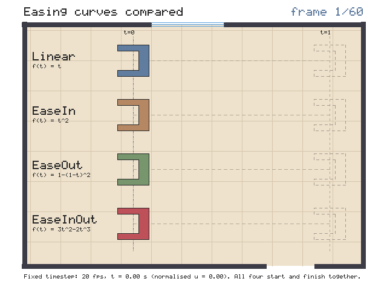
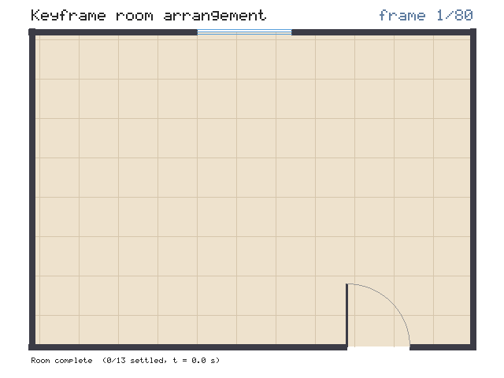
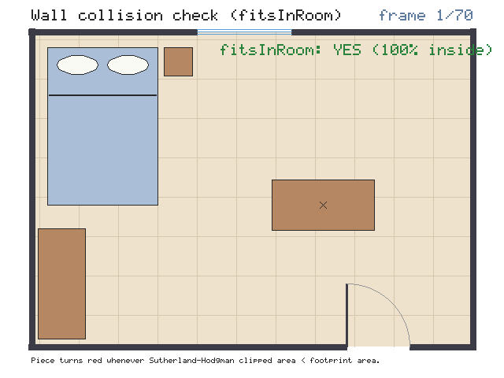
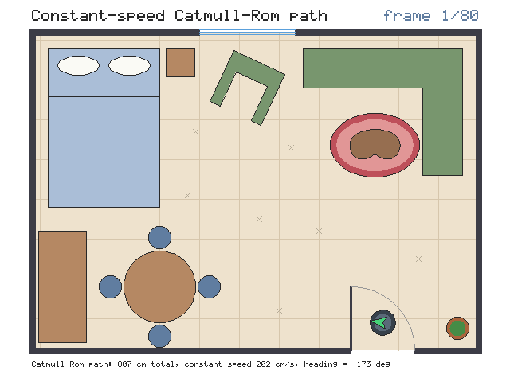

# Part 4a — Animation engine: presenter notes

Issue #8, branch `cp2/anim`.

**What this part is.** Part 1 gave every piece of furniture a `Pose`
(position, angle, scale) and Part 5 gave us `output::AnimationWriter` to stream
frames into a GIF. This part builds the **animation engine** that drives those
poses over time in pure C++17:

- **Fixed-timestep timing** (`anim::FixedTimestep`), so every animation
  advances time deterministically by $\Delta t = 1 / \text{fps}$;
- **Easing curves** (`anim::ease`: `Linear`, `EaseIn`, `EaseOut`, `EaseInOut`),
  which reshape raw time into smooth acceleration and deceleration;
- **Scalar, shortest-arc angle, and pose interpolation** (`anim::lerp`,
  `anim::lerpAngle`, `anim::lerpPose`);
- **Keyframe tracks** (`anim::PoseTrack`), which sort keyframes by timestamp
  and interpolate between the two keys surrounding any query time;
- **Catmull–Rom path motion** (`anim::poseOnPath` and
  `anim::poseOnPathConstantSpeed`), which moves an object along a spline while
  turning it to face its direction of travel and reparameterises the curve by
  arc length so the speed stays constant.

**Run it**

```sh
cmake -S . -B build && cmake --build build
ctest --test-dir build --output-on-failure   # 16 tests, all pass
./build/cp2_anim_demo                        # writes demo_output/cp2/anim_*.gif
```

| Test | Checks | Result |
|---|---|---|
| `test_anim` | 2,012 | 0 failed |
| All 14 earlier CP1 + CP2 tests | unchanged | pass |

Tested with GCC 13.3 on Linux, `-Wall -Wextra -Wpedantic`, no warnings.

---

## Suggested presenting order

1. **Frame-by-frame animation and the fixed timestep** (`FixedTimestep` in
   `src/anim/track.h` and the render loop in `demo/cp2_anim_demo.cpp`).
2. **Linear interpolation** (`lerp` and `lerpPose` in `src/anim/easing.cpp`).
3. **Easing curves** (`ease` in `src/anim/easing.cpp` and `anim_easing.gif`).
4. **Angle interpolation across 360°/0°** (`lerpAngle` in
   `src/anim/easing.cpp` and `testLerpAndAngles` in `tests/test_anim.cpp`).
5. **Keyframing and wall-collision feedback** (`PoseTrack` in
   `src/anim/track.cpp`, `anim_arrange.gif` and `anim_collision.gif`).
6. **Path animation at constant speed** (`poseOnPath` and
   `poseOnPathConstantSpeed` in `src/anim/path.cpp`, and `anim_vacuum.gif`).

---

## 1. Frame-by-frame animation and the fixed timestep

1. **What technique?** Discrete frame-by-frame simulation with a constant time
   step $\Delta t = 1 / \text{fps}$.
2. **How was it implemented?** `struct FixedTimestep` in `src/anim/track.h` /
   `src/anim/track.cpp`:
   - `dt()` returns $1 / \text{framesPerSecond}$ (0.05 s at 20 fps);
   - `frameCount()` returns $\text{round}(\text{durationSeconds} \times \text{fps})$;
   - `frameTime(frameIndex)` returns $\text{frameIndex} \times \Delta t$,
     clamped to `[0, durationSeconds]`;
   - `progress(frameIndex)` returns the normalised fraction
     $\text{frameIndex} / (\text{frameCount} - 1) \in [0, 1]$.
3. **Which component uses it?** Every demo animation in `demo/cp2_anim_demo.cpp`
   (`demoEasing`, `demoArrange`, `demoCollision`, `demoVacuum`).
4. **What does it achieve?** Deterministic, reproducible motion. If an offline
   renderer advanced by wall-clock time between frames, a slow frame would make
   furniture jump ahead. With a fixed timestep, frame $i$ always evaluates the
   scene at the exact simulation time $t_i = i / \text{fps}$ and hands the
   resulting `Canvas` to `output::AnimationWriter`.
5. **Result:** all four demo GIFs (`anim_easing.gif`, `anim_arrange.gif`,
   `anim_collision.gif`, `anim_vacuum.gif`), verified by `testFixedTimestep` in
   `tests/test_anim.cpp`.

## 2. Linear interpolation (`lerp` and `lerpPose`)

1. **What technique?** Linear blending (lerp) between a start value $a$ and an
   end value $b$ using a progress parameter $t \in [0, 1]$.
2. **How was it implemented?** `lerp()` and `lerpPose()` in
   `src/anim/easing.h` / `src/anim/easing.cpp`:
   $$\text{lerp}(a, b, t) = (1 - t)\,a + t\,b$$
   Written in the two-weight form (computed in `double` and cast back to
   `float`) rather than $a + t(b - a)$ so that $t = 0$ returns $a$ and $t = 1$
   returns $b$ exactly without floating-point drift. `lerpPose(a, b, t)`
   interpolates `position.x`, `position.y`, `scaleX` and `scaleY` with `lerp()`
   and `angleDegrees` with `lerpAngle()`.
3. **Which component uses it?** `PoseTrack::sample()` and the furniture
   arrangement and collision demos.
4. **What does it achieve?** Interpolating the **parameters of a `Pose`**
   (position, angle, scale) and rebuilding the 3×3 matrix each frame via
   `xform::poseMatrix(pose)` preserves rigid shapes during rotation. If we
   instead linearly interpolated the entries of two 3×3 rotation matrices,
   their cosines and sines would average toward zero and the furniture would
   visibly shrink in the middle of a turn.
5. **Result:** the `Linear` lane in `anim_easing.gif` and `testLerpAndAngles`
   in `tests/test_anim.cpp`.

## 3. Easing curves

1. **What technique?** Polynomial easing functions (quadratic ease-in,
   quadratic ease-out, and cubic Hermite smoothstep ease-in-out) that map a
   linear time fraction $t \in [0, 1]$ to a curved progress fraction
   $u = f(t) \in [0, 1]$.
2. **How was it implemented?** `ease(Easing, float t)` in `src/anim/easing.h` /
   `src/anim/easing.cpp`. First $t$ is clamped to $[0, 1]$, then:

   | Easing | Formula | Derivative at $t=0$ / $t=1$ | Behaviour |
   |---|---|---|---|
   | `Linear` | $f(t) = t$ | $f'(0) = 1,\; f'(1) = 1$ | Constant speed; abrupt start and stop |
   | `EaseIn` | $f(t) = t^2$ | $f'(0) = 0,\; f'(1) = 2$ | Starts from rest and accelerates |
   | `EaseOut` | $f(t) = 1 - (1 - t)^2$ | $f'(0) = 2,\; f'(1) = 0$ | Starts fast and glides to rest |
   | `EaseInOut` | $f(t) = 3t^2 - 2t^3$ | $f'(0) = 0,\; f'(1) = 0$ | Smoothstep: accelerates then decelerates, $f(0.5) = 0.5$ |

3. **Which component uses it?** Every `PoseTrack` keyframe stores the
   `Easing` curve used to approach that keyframe (`easingIntoKey`).
4. **What does it achieve?** Natural-looking motion. Real objects have mass and
   cannot change velocity instantaneously; easing curves give furniture smooth
   acceleration out of a keyframe and smooth deceleration into the next one
   without changing where or when the keyframes occur.
5. **Result:** `anim_easing.gif` — four identical armchairs starting at the
   same $x = 220$ at $t = 0.20\text{ s}$ and arriving at the same $x = 545$ at
   $t = 2.40\text{ s}$, one per easing curve, with a vertical reference line
   tracking `Linear`.

   

   Tests: `testEasing` in `tests/test_anim.cpp` verifies clamping outside
   $[0, 1]$, exact endpoints $f(0) = 0$ and $f(1) = 1$, monotonicity across 200
   samples per curve, $f(0.5) = 0.5$ for `EaseInOut`, slow start for `EaseIn`,
   and slow finish for `EaseOut`.

## 4. Angle interpolation across the 360°/0° boundary

1. **What technique?** Shortest-arc modular angle interpolation on the circle.
2. **How was it implemented?** `lerpAngle(float aDegrees, float bDegrees, float t)`
   in `src/anim/easing.cpp`:
   - Compute the raw difference $\Delta = \text{fmod}(b - a, 360^\circ)$;
   - Wrap $\Delta$ into the half-open interval $(-180^\circ, 180^\circ]$ by
     subtracting $360^\circ$ if $\Delta > 180^\circ$ or adding $360^\circ$ if
     $\Delta \le -180^\circ$;
   - Compute $a + t \cdot \Delta$ and wrap the final angle into $[0^\circ, 360^\circ)$.
3. **Which component uses it?** `lerpPose()`, which is called by `PoseTrack`
   whenever a piece of furniture rotates between two keyframes.
4. **What does it achieve?** Prevents furniture from spinning the long way
   round when crossing $0^\circ / 360^\circ$. For example, turning from
   $350^\circ$ to $10^\circ$ is a $+20^\circ$ clockwise turn through $0^\circ$
   (midpoint $0^\circ$), whereas plain `lerp(350, 10, 0.5)` would give
   $180^\circ$ — a $-340^\circ$ spin in the wrong direction.
5. **Result:** `anim_arrange.gif` (pieces entering at $340^\circ$–$355^\circ$
   settle smoothly to $0^\circ$ or $25^\circ$ across the seam without spinning
   backwards). `testLerpAndAngles` in `tests/test_anim.cpp` tests both
   $350^\circ \to 10^\circ$ and $10^\circ \to 350^\circ$ at $t = 0, 0.25, 0.5, 0.75, 1$.

## 5. Keyframing (`PoseTrack`) and wall-collision feedback

1. **What technique?** Sorted keyframe track evaluation with interval lookup
   (`std::upper_bound`), local time normalisation, per-key easing, and
   per-frame polygon room-fit verification (`roomcraft::fitsInRoom`).
2. **How was it implemented?** `class PoseTrack` in `src/anim/track.h` /
   `src/anim/track.cpp`:
   - `addKey(timeSeconds, pose, easingIntoKey)` inserts keys in ascending time
     order using `std::lower_bound` (and replaces any existing key at the same
     timestamp so zero-length intervals cannot occur);
   - `sample(timeSeconds)` clamps to the first key's pose when
     $t \le t_{\text{first}}$ and to the last key's pose when
     $t \ge t_{\text{last}}$. For $t \in (t_i, t_{i+1})$, it computes the local
     fraction $u = (t - t_i) / (t_{i+1} - t_i)$, applies
     `ease(keys[i + 1].easingIntoKey, u)`, and calls `lerpPose(keys[i].pose, keys[i + 1].pose, easedU)`.
3. **Which component uses it?** `demoArrange` (13 furniture tracks) and
   `demoCollision` (6-keyframe desk track with `roomcraft::fitsInRoom` checked
   on every frame) in `demo/cp2_anim_demo.cpp`.
4. **What does it achieve?** Complex multi-stage animations defined by just a
   handful of keyframes, combined with live geometric validation on every
   interpolated frame.
5. **Result:** `anim_arrange.gif` and `anim_collision.gif`.

   

   

   In `anim_collision.gif`, the desk slides through the right wall and later
   rotates so a corner pokes through the top wall; on all 28 offending frames
   `roomcraft::fitsInRoom` (Sutherland–Hodgman clipping area check) returns
   `false` and the desk turns bright red, returning to wood colour as soon as it
   re-enters the room.

   Tests: `testPoseTrack` in `tests/test_anim.cpp` checks exact pose values at
   key timestamps, clamping before the first and after the last key, keys added
   out of chronological order, and the midpoint between two `Linear` keys.

## 6. Path animation with constant speed

1. **What technique?** Catmull–Rom spline evaluation with forward-difference
   tangent heading (`poseOnPath`) and arc-length table reparameterisation for
   constant speed (`poseOnPathConstantSpeed`).
2. **How was it implemented?** `poseOnPath()`, `parameterForArcLength()`,
   `pathLength()`, and `poseOnPathConstantSpeed()` in `src/anim/path.h` /
   `src/anim/path.cpp`:
   - **Position:** `raster::evaluateCatmullRomSpline(points, u)` from
     Checkpoint 1 (`src/raster/curves.h`).
   - **Heading:** steps a tiny $\Delta u$ ahead on the spline (or backward at
     $u = 1$) to get the tangent vector $(\Delta x, \Delta y)$ and computes
     $\text{atan2}(\Delta y, \Delta x) \times 180^\circ / \pi$. Because $y$
     points **down** in RoomCraft screen coordinates, $0^\circ$ faces right
     ($+x$) and $+90^\circ$ faces down ($+y$).
   - **Why plain $u$ gives uneven speed:** `evaluateCatmullRomSpline` gives
     every segment between consecutive control points the same parameter width
     $1 / (N - 1)$ regardless of its physical length in centimetres. An object
     advancing at constant $\Delta u$ crawls along short segments and races
     along long ones, and even within a single cubic segment $\|C'(t)\|$ is
     non-constant.
   - **Arc-length table fix:** `buildArcLengthTable()` samples the spline at
     $M$ evenly spaced parameters $u_k = k / M$ and accumulates chord lengths
     $L_k = L_{k-1} + \|P(u_k) - P(u_{k-1})\|$. Given a distance fraction
     $s \in [0, 1]$, `parameterForArcLength()` searches $L$ for
     $d = s \cdot L_{\text{total}}$ with `std::lower_bound`, linearly
     interpolates between the two surrounding table entries to find $u(s)$, and
     evaluates `poseOnPath(points, u(s))`.
3. **Which component uses it?** The robot vacuum in `demoVacuum`
   (`demo/cp2_anim_demo.cpp`), and camera/object path animations in Wave 3.
4. **What does it achieve?** Smooth curve-following through user waypoints at a
   steady physical speed (in cm/s), with the object automatically steering into
   every turn.
5. **Result:** `anim_vacuum.gif` — a round robot vacuum weaving between the bed,
   armchair, coffee table and dining set along an 8-waypoint Catmull–Rom path
   (780 cm total length) at a constant 195 cm/s, rotating its green nose chevron
   to face the tangent direction and leaving a constant-spacing dashed trail.

   

   Tests: `testPoseOnPath` in `tests/test_anim.cpp` verifies that the path
   passes through the first, last and interior control points, faces $0^\circ$
   on a path going right and $+90^\circ$ on a path going down, and covers equal
   arc length in equal time steps within 0.5 px tolerance (whereas plain $u$ on
   the same curve varies in speed by more than $4\times$).

---

## How this part connects to the others

| Part | Connection with `anim` |
|---|---|
| 1 — Transform core (`xform`) | `anim` interpolates `xform::Pose` and converts poses to 3×3 matrices with `xform::poseMatrix` |
| 5 — Output (`output`) | `cp2_anim_demo` streams frames to `output::AnimationWriter` and labels scenes with `output::drawText` |
| 4b — Final showcase (`showcase`) | Combines `anim` tracks and constant-speed paths with `scene` hierarchies and `view` 2D/3D cameras |

---

## Challenges

- **Tangent heading at the very end of a Catmull–Rom spline ($u = 1$).**
  `poseOnPath` estimates the heading from $P(u)$ to $P(u + \Delta u)$, but
  `raster::evaluateCatmullRomSpline` clamps its parameter to $[0, 1]$. At
  $u = 1$, $P(1 + \Delta u)$ clamped to $P(1)$, giving $(\Delta x, \Delta y) = (0, 0)$
  and making the heading snap back to $0^\circ$ on the final frame. Solved by
  clamping the look-ahead window `[u0, u1]` inside `[0, 1]` so that when
  $u + \Delta u > 1$, the tangent is measured from $1 - \Delta u$ to $1$.
- **Dashed trail shimmering behind the robot vacuum.** Drawing the vacuum's
  trail with `raster::drawDashedLine` on polyline segments parameterized by raw
  spline parameter $u$ caused the dashes to stretch on long segments and bunch
  up on short bends. Solved by sampling the trail markers with
  `poseOnPathConstantSpeed` at fixed arc-length fractions so every dash has the
  exact same physical length in centimetres.
- **Rotating decorative details on furniture during keyframe arrangement.** In
  the Checkpoint 1 demo, bed pillows and the inner rug border were drawn at
  hardcoded room coordinates with `fillEllipseMidpoint`. When `demoArrange`
  rotated and scaled the bed and rug via `Furniture::pose`, hardcoded details
  would not follow the piece. Solved in `drawDetailedFurniture()` by defining
  those details as local polygons and transforming them through
  `xform::poseMatrix(piece.pose)`.

## Known limitations

- Arc-length reparameterisation rebuilds its lookup table on each call to
  `poseOnPathConstantSpeed`. With 512 samples this takes microseconds and keeps
  the contract function stateless, but a real-time engine with thousands of
  agents would cache the table alongside the control points.
- `PoseTrack` interpolates position linearly between keyframes; for curved
  trajectories between waypoints, `poseOnPathConstantSpeed` should be used
  instead.
