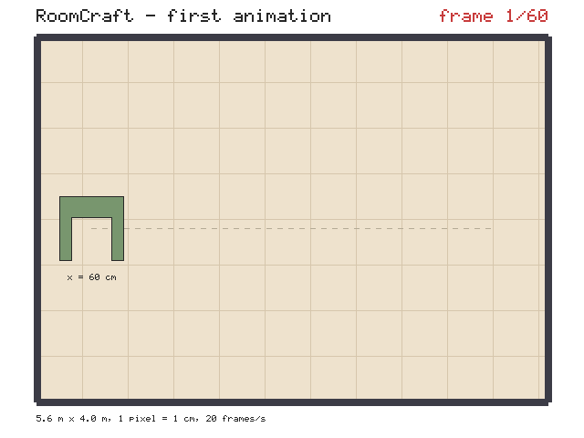
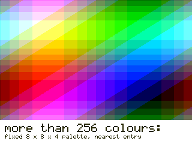
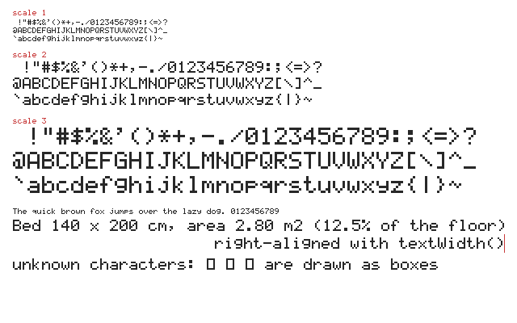

# Part 5a — Animation output: presenter notes

Issue #5, branch `cp2/output`.

**What this part is.** Checkpoint 2 is about animation, but the project could
only write still BMP/PPM pictures. This part adds, in pure C++ with the
standard library only:

- a **GIF89a encoder** written from scratch, including **LZW compression**;
- `output::AnimationWriter`, which every other CP2 part uses to turn a
  sequence of canvases into a looping animation;
- `output::drawText`, a built-in **5×7 bitmap font**, so frames can carry
  captions, counters and measurements (Checkpoint 1 listed "No text" as a
  limitation).

**Run it**

```sh
cmake -S . -B build && cmake --build build
ctest --test-dir build --output-on-failure   # 14 tests, all pass
./build/cp2_output_demo                      # writes demo_output/cp2/output_*
```

| Test | Checks | Result |
|---|---|---|
| `test_gif` | 877 | 0 failed |
| `test_text` | 378 | 0 failed |
| The 11 tests already on `dev` | unchanged | pass |

Tested with GCC 13.3 on Linux, `-Wall -Wextra -Wpedantic`, no warnings.

**How the GIFs were checked**

1. `test_gif` contains its own small GIF/LZW **decoder**, written separately
   from the encoder. It reads every file back and compares every pixel with
   the canvas that was drawn.
2. Both demo GIFs were opened with two decoders we did not write: **Pillow**
   (60 and 40 frames, 50 ms per frame, loop = 0 meaning forever, floor and
   wall colours exactly as drawn) and **ImageMagick** `identify`.
3. Both were loaded in **headless Chromium**: they rendered correctly and the
   screenshot showed "frame 2/60", so the browser had moved past the first
   frame. Headless mode could not capture continuous playback, so **watching
   them play and loop in a normal browser window is still to be done by
   eye** before presenting.

`docs/images/cp2/output_font.png` is a PNG copy of the demo's BMP, converted
with an external tool (ImageMagick) so GitHub can show it, as for the
Checkpoint 1 README. The two GIFs are the program's own output, unmodified.

---

## Suggested presenting order

1. Frame-by-frame animation: play `output_first_animation.gif`, show the loop
   in `firstAnimation()`.
2. What is inside a GIF file (the block list in `gif.h`).
3. LZW compression (`lzwCompress` in `gif.cpp`).
4. The palette: exact colours, and what happens beyond 256
   (`output_palette.gif`).
5. The bitmap font (`output_font`).
6. How we know it is right: the decoder in `tests/test_gif.cpp`.

---

## 1. Frame-by-frame animation

1. **What technique?** Animation as a sequence of complete still pictures
   (frames) shown quickly one after another.
2. **How was it implemented?** `output::AnimationWriter` in
   `src/output/animation_writer.h` / `.cpp`. The caller draws a frame on a
   `Canvas`, calls `addFrame(canvas)`, clears the canvas, draws the next
   frame, and finally calls `finish()`. Each frame is converted and written
   to the file immediately; frames are not kept in memory.
3. **Which component uses it?** Every animated demo in CP2: the door, the
   furniture arranging itself, the camera, the 3D reveal.
4. **What does it achieve?** Motion, from a rasterizer that only knows how to
   draw one picture. It is the software version of "clear, draw, present"
   that a graphics API does every frame.
5. **Result:** `output_first_animation.gif`: 60 frames at 0.05 s, 625 KB.

   

   The loop is in `firstAnimation()` in `demo/cp2_output_demo.cpp`: compute
   the chair's position for this frame, clear, draw the room, draw the chair,
   draw the text, `addFrame`.

   **Frame timing.** GIF stores the time per frame in hundredths of a second,
   so only some speeds are exact: 10 fps = 0.10 s, 20 fps = 0.05 s, 25 fps =
   0.04 s. 30 fps becomes 0.03 s (really 33 fps). Anything faster than 50 fps
   is stored as 0.02 s, because browsers slow shorter delays down to 10 fps.
   `testDelay` checks ten cases.

## 2. The GIF file structure

1. **What technique?** The GIF89a file format: a palette-based image format
   that can hold several images with delays.
2. **How was it implemented?** `output::GifWriter` in `src/output/gif.h` /
   `gif.cpp`, block by block:

   | Block | Bytes | Meaning |
   |---|---|---|
   | Header | `GIF89a` | signature and version |
   | Logical Screen Descriptor | 7 | width, height, "a 256-colour global table follows" |
   | Global Colour Table | 768 | 256 × (r, g, b), shared by all frames |
   | Application Extension | 19 | `NETSCAPE2.0`, loop count 0 = loop forever |
   | per frame: Graphic Control Extension | 8 | delay for this frame |
   | per frame: Image Descriptor | 10 | position and size |
   | per frame: Image Data | varies | LZW minimum code size, then the compressed pixels in sub-blocks of at most 255 bytes, ended by a 0 |
   | Trailer | `0x3B` | end of file |

   Multi-byte numbers are little-endian, written byte by byte like the
   Checkpoint 1 BMP writer.
3. **Which component uses it?** `AnimationWriter` sits on top of it.
4. **What does it achieve?** A file any browser, image viewer or GitHub page
   can play, with no library and no external tool.
5. **Result:** both demo GIFs. `testAnimationRoundTrip` and `testErrors`
   check the signature, size, table flag and size, loop extension, frame
   count, delay, disposal method, sub-block sizes and the trailer.

## 3. LZW compression

1. **What technique?** Lempel–Ziv–Welch dictionary compression, the
   variable-code-length variant GIF requires.
2. **How was it implemented?** `lzwCompress()` in `src/output/gif.cpp`.
   - The **code table** starts with one code per palette index (0–255), then
     two special codes: CLEAR (256) and END (257). New codes start at 258.
   - Keep the longest sequence already in the table (`prefix`). Read the next
     pixel `c`. If `prefix + c` is in the table, keep extending. If not:
     output the code for `prefix`, add `prefix + c` as a new code, restart
     from `c`.
   - A sequence is stored as the pair (prefix code, last pixel) in an
     `unordered_map`, so no pixel lists are copied.
   - **Growing code size:** codes start at 9 bits and grow to 10, 11, 12 as
     the table fills. The switch happens when the code just handed out no
     longer fits, which is exactly when the decoder, building the same table
     one step behind, switches too.
   - **Table full:** at 4096 codes (12 bits) the encoder writes CLEAR and
     starts a new table.
   - Codes are packed into bytes lowest bit first by the small `BitPacker`
     class.
3. **Which component uses it?** Every frame of every GIF.
4. **What does it achieve?** Small files. The table is never stored: the
   decoder rebuilds it from the codes. Flat-coloured floor plans compress
   very well because long runs become single codes.
5. **Result:** the first animation is 60 frames of 640×480 = 18.4 million
   pixels in 625 KB, about 3% of one byte per pixel. In `testLzwRoundTrip`,
   100,000 identical pixels compress to under 700 bytes, and a picture-like
   input of long runs to under a tenth of its size.

   Tests: `testLzwRoundTrip` compresses and decodes a flat run (the case
   where the decoder meets a code it has not finished defining), 200,000
   random pixels (the table fills and clears many times), 30 lengths chosen
   around the points where the code size grows, repeating patterns of seven
   periods, and every minimum code size from 2 to 8.

## 4. Palette building

1. **What technique?** Converting 24-bit RGB pixels to indices into a
   256-colour table (colour quantisation).
2. **How was it implemented?** `AnimationWriter::convertFrame()` in
   `src/output/animation_writer.cpp`.
   - **Normal case, exact colours.** The rasterizer draws flat colours, so an
     animation normally uses a handful. Each new colour gets the next free
     palette entry; a hash map remembers colour → entry. Nothing is lost.
   - **The palette is written late.** Frames are streamed before all colours
     are known, so the file starts with 256 black entries and the table is
     rewritten in place (it sits at byte 13) after any frame that added a
     colour.
   - **More than 256 colours in the first frame** (a gradient): the whole
     animation uses a **fixed palette** of 8 red × 8 green × 4 blue levels,
     and each pixel is mapped to the nearest entry by squared RGB distance.
   - **More than 256 colours reached in a later frame:** the palette is
     **frozen** and each further new colour is mapped to the nearest colour
     already in it. The earlier frames are already in the file with the exact
     palette, so it cannot be replaced.
   - There is always **one palette for the whole file**, the same for every
     frame (no local colour tables).
3. **Which component uses it?** Every frame of every GIF.
4. **What does it achieve?** Exact colours for normal RoomCraft animations,
   and a sensible picture instead of a failure when there are too many.
5. **Result:** `output_palette.gif`. Its first frame has 61,727 different
   colours. The smooth gradient comes out in visible bands, which is the cost
   of 256 colours; the white strip and the text stay sharp.

   

   The first animation, by contrast, uses 8 colours and all are exact.

   Tests: `testFixedPaletteFallback` checks by brute force that every pixel
   is a nearest palette colour, that the 256 entries are all different, and
   that black and white survive exactly. `testPaletteFreezesWhenFull` checks
   that earlier frames stay exact, that exactly the 56 colours that still fit
   are exact, and that the rest map to their nearest entry. `testLargeFrames`
   checks that exactly 256 colours are still stored exactly.

## 5. The bitmap font

1. **What technique?** Bitmap (raster) text: each character is a small grid
   of on/off cells.
2. **How was it implemented?** `drawText()`, `textWidth()` and `textHeight()`
   in `src/output/text.h` / `text.cpp`. The font is a table of 95 characters
   (space to `~`), each 7 bytes: one byte per row, the low 5 bits are the 5
   cells of that row. Drawing copies the "on" cells to the canvas with
   `setPixel`; with `scale` each cell becomes a scale × scale block.
   Characters advance by 6 cells (5 plus a gap). Characters outside the
   table are drawn as an empty box rather than skipped. The glyph shapes
   follow the classic 5×7 dot-matrix character set used by character LCD
   displays.
3. **Which component uses it?** Captions and frame counters in animations,
   labels and measurements on the floor plan.
4. **What does it achieve?** Labelled output. The other parts' demos can say
   on screen which technique is being shown.
5. **Result:** `output_font`: all 95 characters at scale 1, 2 and 3, sample
   lines, a line right-aligned with `textWidth()`, and unknown characters as
   boxes.

   

   Tests: `test_text` checks the exact 35 cells of `A`, `7` and `g`, the
   6-pixel advance, that all 95 glyphs are different and stay inside their
   cell, `textWidth` against what is really drawn at four scales, scaling
   (scale 3 is 9 times the ink), and text running off every edge compared
   pixel by pixel with the same text on a larger canvas.

---

## How the other parts use this

```cpp
output::AnimationWriter gif("demo_output/cp2", "name", 640, 480, 20);
for (each frame) {
    canvas.clear(255, 255, 255);
    // draw the scene for this moment
    output::drawText(canvas, 40, 10, "caption", raster::Color{40, 40, 40}, 2);
    gif.addFrame(canvas);
}
gif.finish();
```

- Keep to flat colours and the palette stays exact.
- If later frames will contain gradients that the first frame does not, call
  `gif.useFixedPalette()` before the first frame.
- For a file under 2 MB, 60 frames of 640×480 flat-colour floor plan is about
  0.6 MB.

---

## Challenges

- **The palette has to be in the file before the frames, but is not known
  until the last frame.** Frames must be streamed, not stored. Solved by
  writing a placeholder table and rewriting it in place after each frame
  that adds a colour. A consequence: if the 257th colour first appears in a
  later frame, the earlier frames cannot be re-encoded, so the palette is
  frozen and new colours take the nearest existing entry. This differs from
  the task brief, which asked for the fixed palette whenever there are more
  than 256 colours; the fixed palette is used only when the first frame
  already has too many, or when `useFixedPalette()` is called.
- **Two test expectations were wrong, not the code.** The first test run had
  four failures. The hand-drawn expected picture of the letter `g` was one
  row too low, and a "flat colour" frame in the large-frame test used black,
  which was a 257th colour and so was correctly approximated. Both tests were
  corrected after checking the font table and counting the colours.
- **Proving in a browser that the GIF animates.** Reading the image through a
  page script always returned the first frame (drawing an animated image to
  a canvas uses its first frame), and headless Chromium screenshots taken at
  three different times were identical. The screenshot did show "frame 2/60",
  so the browser had advanced, but continuous playback has to be confirmed by
  eye.

## Known limitations

- At most 256 colours per animation; beyond that colours are approximated as
  described above, with no dithering, so gradients show bands.
- When the palette freezes mid-animation, the result depends on which colours
  appeared first.
- Every frame stores the whole picture. Frames are not reduced to the part
  that changed, so files are larger than an optimising encoder would make.
- Frame time has a resolution of 0.01 s and a minimum of 0.02 s.
- The colour table always has 256 entries and pixel codes start at 9 bits,
  even for a two-colour animation.
- Text is one line, one fixed-width font, ASCII only; non-ASCII characters
  are drawn as one box per byte.
- Lower-case letters with tails (g, j, p, q, y) are squeezed into the same 7
  rows as the other letters.
