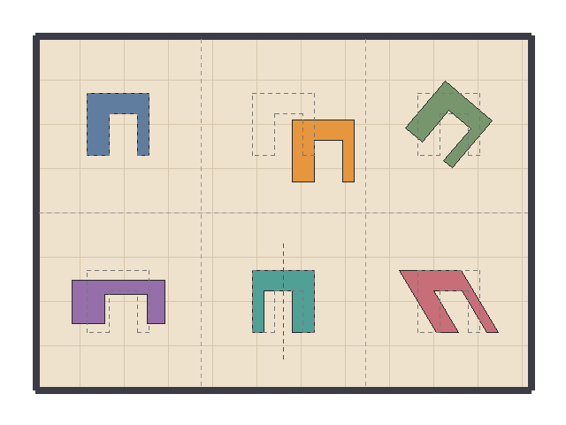
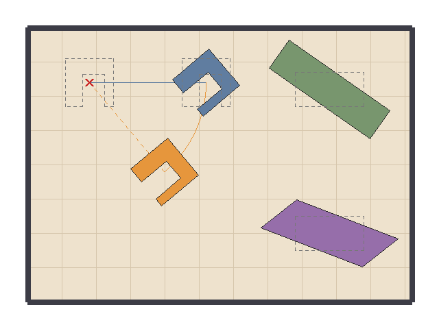
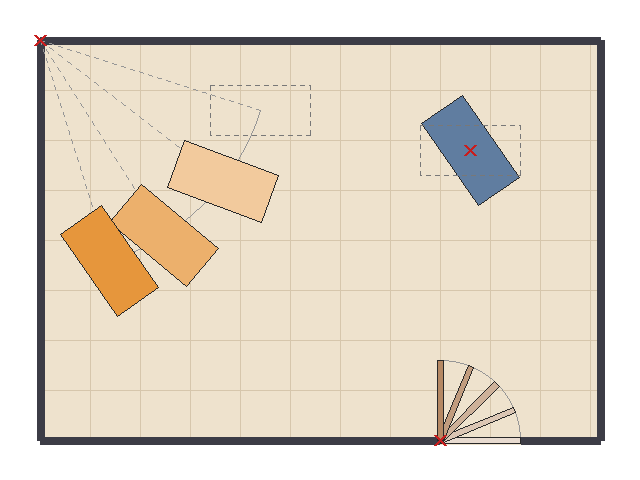
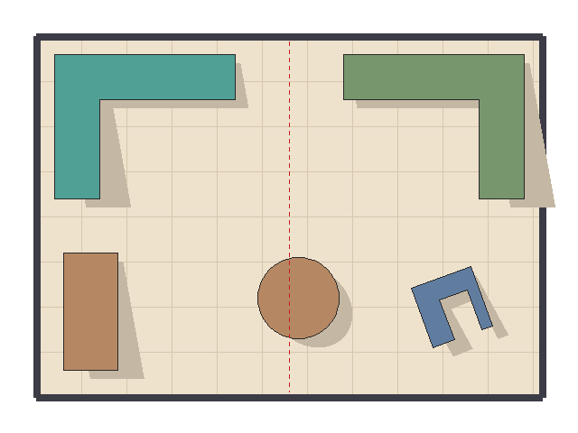
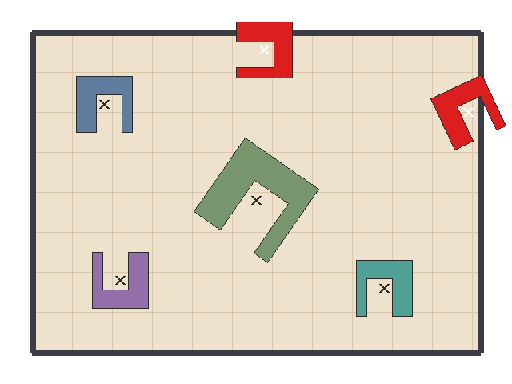

# Part 1 — Transform core: presenter notes

Issue #4, branch `cp2/transform`.

**What this part is.** Checkpoint 1 could move, turn and resize a polygon by
rewriting its vertices. This part replaces that with **3×3 homogeneous
matrices** (`xform::Mat3`) and gives every piece of furniture a **pose**
(position, angle, scale). Every other CP2 part builds on these two things:
cameras, hierarchical models and animation all work by building a matrix per
frame.

**Run it**

```sh
cmake -S . -B build && cmake --build build
ctest --test-dir build --output-on-failure   # 11 tests, all pass
./build/cp2_transform_demo                   # writes demo_output/cp2/transform_*.bmp
```

| Test | Checks | Result |
|---|---|---|
| `test_mat3` | 4,683 | 0 failed |
| `test_pose` | 162 | 0 failed |
| All 8 Checkpoint 1 tests | unchanged | pass |

Tested with GCC 13.3 on Linux, `-Wall -Wextra -Wpedantic`, no warnings.

**Reading the images.** A dashed outline is the shape before the transform, a
solid shape is the result, and a cross marks a pivot or a pose position. There
are no labels in the images, because text drawing belongs to Part 5; the demo
prints the legend and the numbers to the terminal instead.

The PNG files in `docs/images/cp2/` are copies of the demo's BMP files,
converted with an external tool (ImageMagick) so GitHub can display them, as
was done for the Checkpoint 1 README. The program itself writes only BMP.

---

## Suggested presenting order

1. Homogeneous coordinates: why a 3×3 matrix (show `mat3.h`).
2. The basic transforms (`transform_basic`).
3. Composite transforms and why order matters (`transform_order`).
4. Pivot transforms: the door (`transform_pivot`).
5. Reflection and shear in use (`transform_mirror`).
6. Inverse (show `testInverse` in `tests/test_mat3.cpp`).
7. The pose refactor (`transform_pose`, then `furniture.h`).

---

## 1. Homogeneous coordinates

1. **What technique?** Writing a 2D point (x, y) as the column vector
   (x, y, 1), so that every 2D transform, including translation, is one 3×3
   matrix.
2. **How was it implemented?** `struct Mat3` in `src/xform/mat3.h`, stored as
   `m[row][column]`. `transformPoint()` in `src/xform/mat3.cpp` multiplies the
   matrix by (x, y, 1) and divides by the third component. Points are column
   vectors, `p' = M * p`.
3. **Which component uses it?** Every piece of furniture, the door, and all
   the other CP2 parts.
4. **What does it achieve?** A 2×2 matrix can rotate and scale but cannot
   translate, because it always leaves the origin where it is. The extra
   column holds the offset, so translation becomes a multiplication too. A
   whole chain of transforms then collapses into one matrix that is applied to
   every vertex once.
5. **Result:** all five demo images are drawn through `Mat3`.
   `testBasicMatrices` checks that the origin stays fixed under rotation,
   scaling and shear but moves under translation.

## 2. The basic transforms

1. **What technique?** Translation, rotation, scaling, reflection and shear.
2. **How was it implemented?** Static functions on `Mat3` in
   `src/xform/mat3.cpp`:

   | Function | Matrix (top two rows) | Effect |
   |---|---|---|
   | `translation(tx, ty)` | `1 0 tx` / `0 1 ty` | adds an offset |
   | `rotation(a)` | `cos −sin 0` / `sin cos 0` | turns about the origin |
   | `scaling(sx, sy)` | `sx 0 0` / `0 sy 0` | resizes about the origin |
   | `shear(shx, shy)` | `1 shx 0` / `shy 1 0` | slants: x' = x + shx·y |
   | `reflectionAcrossXAxis()` | `1 0 0` / `0 −1 0` | flips y |
   | `reflectionAcrossYAxis()` | `−1 0 0` / `0 1 0` | flips x |

   Rotation uses the same formula as the Checkpoint 1 `raster::rotate`.
   Because y points **down** on screen, a positive angle turns **clockwise**.
3. **Which component uses it?** Furniture: drag (translate), turn (rotate),
   resize (scale), flip a piece to fit the other side of the room (reflect).
4. **What does it achieve?** The editor operations the proposal promised, in a
   form that can be combined and animated.
5. **Result:** `transform_basic`. One armchair, six cells: original,
   translated, rotated 40°, scaled (1.5, 0.7), reflected, sheared. The chair
   has one wide arm and one narrow arm so a mirror image cannot be mistaken
   for a rotation.

   

   The terminal output shows the determinant of each matrix: 1 for
   translation, rotation and shear (area unchanged), 1.05 for the scale (area
   3396 → 3566 cm²), and −1 for the reflection (same area, mirrored).

   Tests: `testBasicMatrices` (hand-computed points) and
   `testAgreesWithCheckpoint1`, which compares `Mat3` with `raster::translate`,
   `raster::rotate` and `raster::scale` for every 15° over three full turns
   about four different pivots.

## 3. Composite transforms and why order matters

1. **What technique?** Multiplying matrices to chain transforms.
2. **How was it implemented?** `operator*` in `src/xform/mat3.cpp`
   (row-times-column product). Because points are column vectors, in `A * B`
   the transform **B is applied first**: read a chain from right to left.
3. **Which component uses it?** Everything that needs more than one step:
   pivot rotation, the mirror line, the pose matrix.
4. **What does it achieve?** One matrix per piece per frame, however many
   steps it stands for. It also means the order must be chosen deliberately,
   because matrix multiplication is not commutative.
5. **Result:** `transform_order`.

   

   - Left: T = translation(170, 0), R = rotation(50), about the red cross.
     **T·R** (blue) turns the chair on the spot and then slides it right: it
     ends at (300, 120). **R·T** (orange) slides first and then rotates about
     the cross, so the slide itself is swung round the arc: it ends at
     (239, 250).
   - Right: S = scaling(1.8, 1), R = rotation(35) on a desk. **R·S** (green)
     stretches then turns, and is still a rectangle. **S·R** (purple) turns
     then stretches along the room's x axis, which skews the desk into a
     parallelogram.

   Tests: `testOrderMatters` checks both orders against hand-computed points,
   that grouping does not matter (associativity), and that two translations
   or a rotation with a uniform scale do commute.

## 4. Transforms about a pivot

1. **What technique?** Rotation and scaling about any point, built as a
   composite.
2. **How was it implemented?** `Mat3::rotationAbout` and `Mat3::scalingAbout`
   in `src/xform/mat3.cpp`:

   `M = T(+P) · R(angle) · T(−P)`

   Move the pivot to the origin, rotate there, move it back. The pivot goes
   P → origin → origin → P, so it stays fixed.
3. **Which component uses it?** The door (hinge), and any piece turned on the
   spot (its own centre).
4. **What does it achieve?** A door that swings on its hinge instead of flying
   round the canvas corner.
5. **Result:** `transform_pivot`.

   

   - Bottom right: the door at 0°, −22.5°, −45°, −67.5°, −90° about its hinge.
     Opening into the room is a negative angle (counter-clockwise on screen).
   - Left: a desk rotated about the **room corner** by 20°, 40°, 55°. The
     pivot is far away, so the desk travels along a circle: its centre goes
     from (260, 110) to (109, 260).
   - Top right: the same desk shape rotated 55° about **its own centre**: it
     turns on the spot.

   Tests: `testPivotTransforms` checks that the pivot is fixed for twelve
   angles, where the end of the door lands, and that `rotationAbout` equals
   the three-matrix product exactly.

## 5. Reflection and shear in use

1. **What technique?** Reflection in an arbitrary vertical line; shear for a
   drop shadow.
2. **How was it implemented?** In `demo/cp2_transform_demo.cpp`, `imageMirror`:
   - Mirror in the line x = 320: `T(320, 0) · reflectY · T(−320, 0)`, the same
     move-transform-move-back pattern as the pivot rotation.
   - Shadow: `T(6, 10) · T(p) · shear(0.18, 0) · T(−p)`, where p is the
     top-left corner of the piece's bounding box. The shadow is filled before
     the piece.
3. **Which component uses it?** The L-shaped sofa (mirrored to fit the
   opposite corner) and all pieces (shadows).
4. **What does it achieve?** A left-handed sofa from a right-handed one
   without redefining the shape, and a hint of depth on the flat plan.
5. **Result:** `transform_mirror`.

   

   The mirror matrix has determinant −1. The sofa keeps its area (15,500 cm²)
   but its signed area changes sign, because a mirror image reverses the
   vertex order. `fitsInRoom` still says yes for the mirrored sofa, because
   the area functions use the absolute value.

   Tests: `testAreaAndDeterminant` (reflecting twice is the identity; shear
   keeps area; scaling multiplies area by sx·sy; det(A·B) = det(A)·det(B)).

## 6. Inverse

1. **What technique?** Matrix inverse by the adjugate and determinant.
2. **How was it implemented?** `inverse()` and `determinant()` in
   `src/xform/mat3.cpp`: `inverse(M) = adjugate(M) / det(M)`, where the
   adjugate is the transposed matrix of 2×2 cofactors. Returns `false` when
   the determinant is 0.
3. **Which component uses it?** Nothing in this part's demo draws with it. It
   is provided for the other parts: a camera needs it to turn a click on
   screen back into room coordinates.
4. **What does it achieve?** Undoing any transform. A matrix with determinant
   0 (for example a scale by 0) has squashed the plane onto a line, so there
   is nothing to undo it with, and the function reports that instead of
   dividing by zero.
5. **Result:** no image. `testInverse` checks, for ten composites, that
   `M · inverse(M)` and `inverse(M) · M` are the identity and that a polygon
   transformed and transformed back returns to its vertices; it checks the
   known inverses (translation by the opposite offset, rotation by the
   opposite angle); and it checks that five singular matrices return `false`
   and leave the output untouched.

## 7. The pose refactor

1. **What technique?** Keeping the model in local coordinates and placing it
   with a model matrix built from a pose.
2. **How was it implemented?**
   - `struct Pose` and `poseMatrix()` in `src/xform/pose.h` / `pose.cpp`:
     `translation(position) · rotation(angle) · scaling(scaleX, scaleY)`,
     i.e. scale, then rotate, then move.
   - `roomcraft::Furniture` gained `xform::Pose pose` and
     `worldFootprint()` in `src/roomcraft/furniture.h` / `furniture.cpp`.
     `hitTest`, `findFurnitureAt`, `fitsInRoom`, `areaInsideRoom` and
     `drawFurniture` now all work on the world footprint.
3. **Which component uses it?** Every piece of furniture.
4. **What does it achieve?**
   - The shape is defined once and never modified, so rotating a little on
     each frame cannot pile up rounding errors.
   - "Where is it and how far is it turned?" is stored as plain numbers, which
     is what the animation part interpolates.
   - Checkpoint 1 code is unaffected: with the default pose the world
     footprint is bit-for-bit the stored footprint. All eight CP1 tests pass
     unchanged.
5. **Result:** `transform_pose`.

   

   One local armchair footprint placed six times by pose alone: as designed,
   enlarged and turned, turned 180°, mirrored with a negative scaleX, and two
   placements that stick through a wall, which `fitsInRoom` flags and the demo
   draws in red. The crosses are the pose positions.

   Tests: `test_pose` checks the scale-rotate-move order against hand-computed
   points (and that the other order gives a different answer), hit testing
   and `fitsInRoom` on moved, turned, scaled and mirrored pieces, and that
   every pixel `drawFurniture` fills also passes `hitTest`.

---

## How this part connects to the others

| Part | Uses from this part |
|---|---|
| 2 — Hierarchy and 3D geometry | `Mat3`, `Pose` (child pose relative to parent), `Vec3`, `WireMesh` |
| 3 — Viewing and projection | `Mat3` (window to viewport), `inverse` (click to room), `Vec3`, `Vec4`, `WireMesh` |
| 4 — Animation engine | `Pose` (interpolated between keyframes), `Furniture::pose` |

---

## Challenges

- **Adding the pose member broke the warning-free build.** `Furniture` is
  initialised in Checkpoint 1 code as `{name, footprint, colour}`. With a
  fourth member, GCC's `-Wextra` reported "missing initializer for member
  `pose`" at 12 places in `demo/roomcraft_demo.cpp` and
  `tests/test_furniture.cpp`, even though the member has a default value.
  Fix: add an explicit `{}` for the pose at those 12 places. This is the only
  change made to Checkpoint 1 files, and it does not change behaviour.
- **A click on a chair's pose position reported "miss".** In the pose demo, a
  hit test at exactly the position of the big green chair failed, which looked
  like a bug in `worldFootprint`. It was correct: the armchair footprint is
  concave, and its local origin lies on the open seat between the arms, which
  is not part of the footprint. The demo now clicks the back of the chair
  (hit), the open seat (miss) and the local coordinates (miss), and prints all
  three.

## Known limitations

- Matrices store `float`. Products and point transforms are computed in
  `double` and rounded, and the tests bound the error at a few thousandths of
  a pixel for room-sized coordinates, but very long chains of accumulated
  products will drift. Rebuilding the matrix from a pose each frame avoids
  this.
- Round furniture is still a many-sided polygon footprint, as in Checkpoint 1.
  A non-uniform pose scale turns it into an ellipse-shaped polygon, which is
  correct, but drawing it with the midpoint circle algorithm would not follow
  the pose.
- The demo writes still images. Animated output arrives with Part 5.
