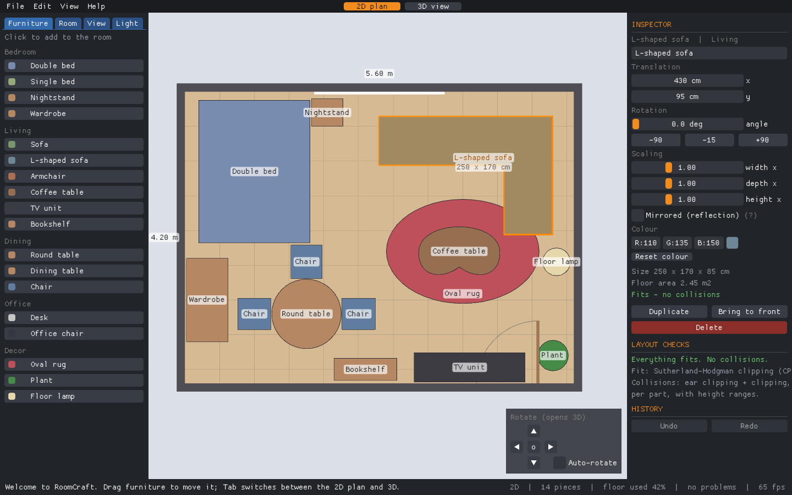
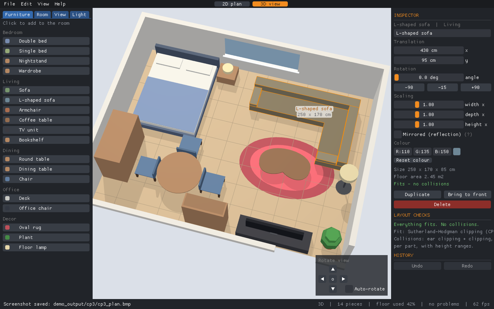
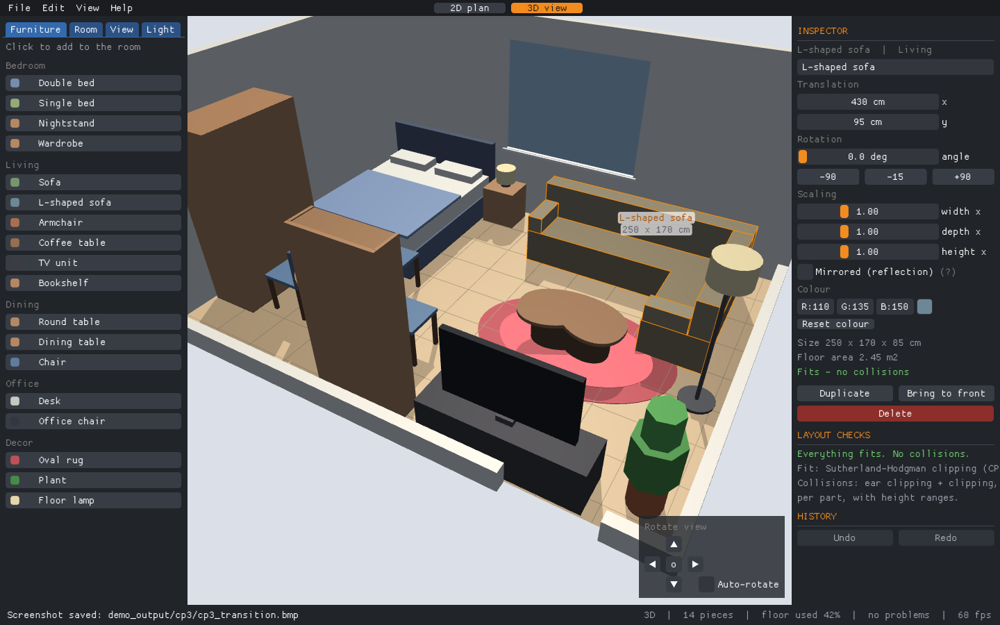
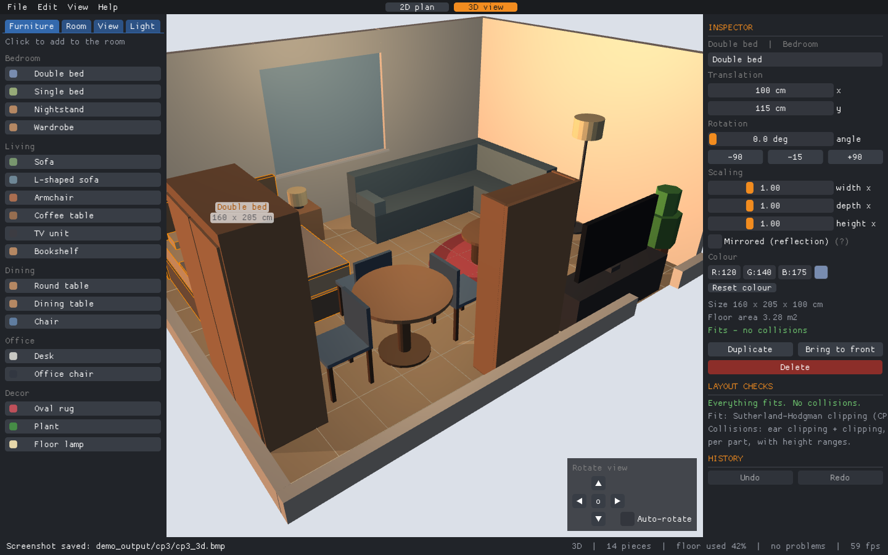
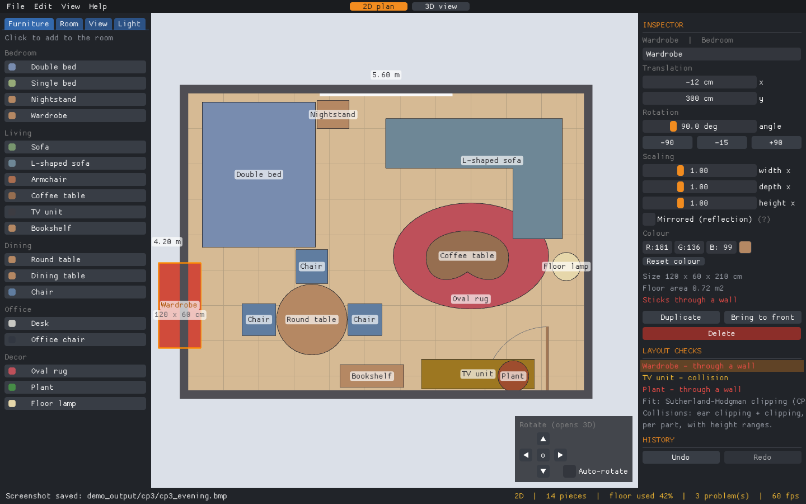
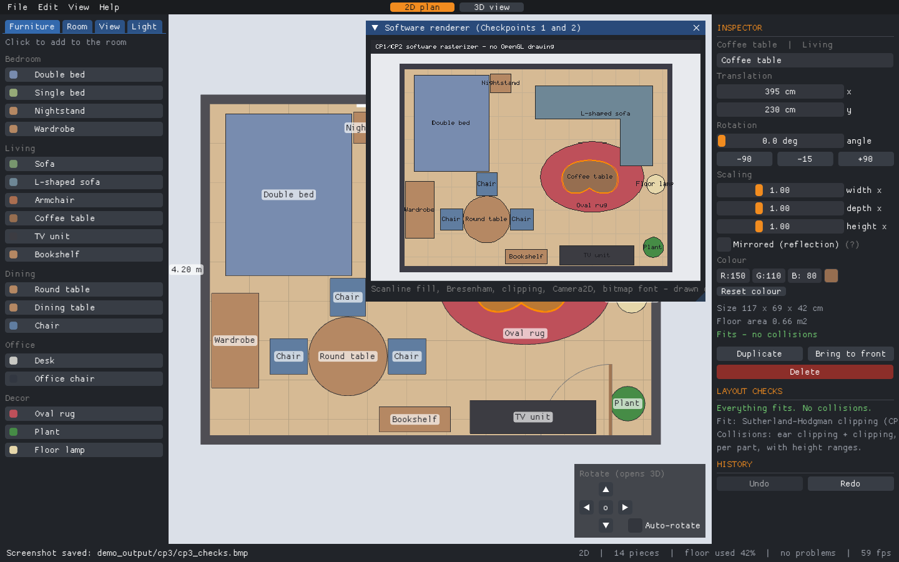
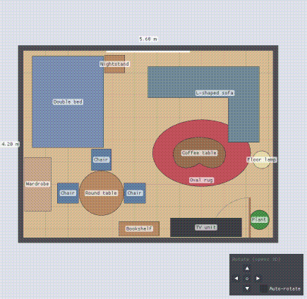

# Checkpoint 3 — OpenGL integration and interactive prototype: presenter notes

Branch `cp3/opengl`. CP3 asks us to integrate the project components and the
previous work into an OpenGL-based implementation and combine them into a
functional prototype. This file is the material for the CP3 showcase video:
what was built, how each technique works, and where to point the camera.

## Run it

```sh
cmake -S . -B build                 # first time: downloads GLFW 3.4 and Dear ImGui 1.91.9b
cmake --build build -j
./build/roomcraft_app               # run from the repository root
```

`./build/roomcraft_app --capture demo_output/cp3` runs a scripted tour in a
hidden window, saves the screenshots and GIF used below, and checks real
mouse/keyboard interactions (it exits with code 1 if any fails).

| Image | Shows |
|---|---|
|  | `cp3_plan`: the 2D plan drawn by OpenGL, the L-sofa selected, labels and room dimensions |
|  | `cp3_transition`: half way through the 2D-to-3D transition — furniture growing, light fading in |
|  | `cp3_3d`: the lit 3D view with shadows, cutaway walls and the selection outline |
|  | `cp3_evening`: evening preset — low orange sun plus the ceiling lamp (point light) |
|  | `cp3_checks`: a wardrobe through the wall (red) and a plant colliding with the TV unit (amber) |
|  | `cp3_software`: the same layout drawn by the CP1/CP2 software rasterizer, next to the OpenGL view |
|  | `cp3_tour.gif`: plan → 3D → a third of an orbit → plan, recorded by the app's own GIF recorder |

---

## 1. Proposed project vs actual project (at CP3)

| Proposal | CP3 status | What to say |
|---|---|---|
| Web app with Three.js | **Changed** | Desktop C++17 app with OpenGL 3.3 core, as the course requires. Instead of Three.js's camera and scene classes we use our own CP2 matrices (`view::Mat4`, `lookAt`, `perspective`, `orthographic`) and upload them to our own GLSL shaders. |
| 2D grid editor: drag, drop, rotate | **Done** | Click to select, drag with grid snapping, rotate (R, Shift+wheel, inspector), scale, mirror, duplicate, delete, undo/redo. Furniture is added from a palette by clicking, not by drag-and-drop from the palette. |
| Rectangular room with adjustable dimensions | **Done** | Width, depth and wall height in the Room tab; the door and window follow the walls. |
| Real-time 2D-to-3D conversion | **Done** | One layout, two views. Every edit shows immediately in both; Tab switches with an animated transition. |
| Basic 3D furniture as simple shapes | **Done, extended** | 18 catalogue types, each a multi-part model (a bed is a base, mattress, duvet, headboard and pillows) built by extruding plan polygons. |
| 3D camera: orbit, zoom, pan | **Done** | Rotate by dragging empty floor or right-dragging, with Q/E or the arrow keys, with the corner buttons, or with auto-rotate (spherical coordinates). The wheel zooms towards the mouse; middle-drag pans. |
| Ambient + directional/point light, Phong-style shading | **Done** | Blinn–Phong in our fragment shader: ambient, a sun (directional) and a ceiling lamp (point light with attenuation). Day/Evening/Night presets. |
| Colour selection for walls and furniture | **Done** | Colour pickers for every piece, the floor and the walls. |
| Scene graph room → walls → furniture | **Done, simplified** | Room → piece (pose) → parts. Each part's world placement is the piece's pose matrix applied to the part's local polygon. |
| Smooth camera transition between 2D and 3D | **Done** | Eased elevation, azimuth and a dolly zoom from orthographic to perspective (see technique 5). |
| Boundary/collision checking | **Done, extended** | Fit check (CP1 Sutherland–Hodgman) plus a 3D-aware collision check between pieces. "Keep inside the walls" clamps dragging. |
| Persistent save/load to a database | **Out of scope, as proposed** | We added simple save/open of layouts as text files instead (no database). |
| Non-rectangular rooms, photorealism, physics | **Out of scope, as proposed** | Unchanged. |

**Added beyond the proposal:** undo/redo, a layout-checks list, screenshots
(BMP) and GIF recording through our CP1/CP2 code, a side-by-side software
rasterizer view, cutaway walls, floor shadows, example layouts.

---

## 2. Components and how they relate

```
            ┌──────────────── app/ (roomcraft_app) ───────────────┐
 mouse,     │ main loop · ImGui panels · input → editor commands  │
 keyboard ─►│ labels · screenshots/GIF · software view panel      │
            └──────┬───────────────────────────┬──────────────────┘
                   │ edits                     │ draws
                   ▼                           ▼
   ┌─────── src/editor/ (no OpenGL, tested) ──────┐   ┌── src/gfx/ (OpenGL) ──┐
   │ Editor: selection, drag, undo/redo, checks   │   │ Shader (GLSL)         │
   │ Layout: room, items, save/load, collisions   │──►│ GpuMesh (VAO/VBO/EBO) │
   │ Catalogue: 18 multi-part furniture types     │   │ Renderer: plan / 3D,  │
   │ Triangulate (ear clipping), overlap area     │   │ lighting, shadows,    │
   │ Mesh building (CPU), walls with openings     │   │ cutaway, selection    │
   │ CameraRig (plan↔3D), rays, picking           │   └───────────────────────┘
   └──────────────────────┬───────────────────────┘
                          │ uses
   ┌──────────────────────▼──────────────────────────────────────────────┐
   │ CP1: raster (polygons, clipping, point-in-polygon, curves, canvas)  │
   │      roomcraft (Furniture, hitTest, findFurnitureAt, fitsInRoom)    │
   │ CP2: xform (Mat3, Pose) · view (Mat4, lookAt, projections, orbit,   │
   │      Camera2D) · scene (extrude) · anim (easing, lerp) · output     │
   │      (GIF encoder, bitmap font)                                     │
   └─────────────────────────────────────────────────────────────────────┘
```

| Component | Purpose | Code |
|---|---|---|
| Room | Floor, four walls with thickness, a door (open leaf) and a window (glass, sill) | `editor/layout.*`, `editor/mesh.cpp` (`buildWalls`, `addOpeningModel`) |
| Furniture catalogue | 18 types in 5 categories; plan footprint + 3D parts | `editor/catalogue.*` |
| Layout and items | What the user edits and saves: room + items (type, pose, colour, height scale) | `editor/layout.*`, `layouts/*.rclayout` |
| Editor | Every change, with undo/redo and gestures | `editor/editor.*` |
| Camera rig | One camera for plan and 3D, and the transition | `editor/camera_rig.*` |
| Picking | Mouse → ray → piece | `editor/picking.*`, `App::pickUnderMouse` |
| Renderer | Draws the scene with OpenGL | `gfx/*` |
| UI | Menu, catalogue, room/view/light tabs, inspector, checks, status bar | `app/ui.cpp` |
| Capture | Screenshot, GIF recording, scripted tour | `app/capture.cpp` |
| Software view | The CP1/CP2 rasterizer drawing the same layout | `app/software_view.cpp` |

**One source of truth:** the `Layout`. The 2D plan, the 3D view, the software
view, the checks and saved files are all derived from it; nothing is stored
twice. That is why an edit in either view shows instantly in the other.

---

## 3. Techniques and algorithms (the five questions)

### 1. OpenGL rendering pipeline (buffers, shaders, depth test)

1. **What?** The programmable OpenGL 3.3 core pipeline: vertex data in GPU
   buffers, a vertex shader that transforms each vertex, rasterisation by the
   GPU, a fragment shader that colours each pixel, and a depth buffer for
   hidden-surface removal.
2. **How?** `gfx::GpuMesh` uploads an `editor::MeshData` (position, normal,
   colour per vertex; indices) into a VBO/EBO and records the layout in a VAO.
   `gfx::Shader` compiles and links the GLSL source in `gfx/renderer.cpp`.
   The functions are loaded at run time with glad (`third_party/glad`).
3. **Component:** everything drawn in the room view.
4. **Achieves:** real-time drawing at the screen's refresh rate (60 fps on the
   test machine) instead of the CP1/CP2 CPU rasterizer.
5. **Show:** any screenshot; turn on *View → Wireframe* to see the triangles.

### 2. Our matrices driving OpenGL

1. **What?** Model, view and projection transforms from CP2 used as the GPU
   transforms.
2. **How?** `CameraRig::state` builds `view::viewMatrix` (orbit + `lookAt`)
   and `view::Mat4::perspective` / `orthographic`; `projection * view` is
   uploaded with `glUniformMatrix4fv(..., GL_TRUE, ...)` — `GL_TRUE` because
   our matrices are stored row-major and OpenGL expects column-major. The
   model matrix stretches heights during the transition and flattens shadows.
3. **Component:** the camera, every mesh.
4. **Achieves:** the CP2 math is the real renderer's math; there is no GLM.
5. **Show:** `gfx/shader.cpp` (`Shader::set(const char*, const view::Mat4&)`).

### 3. Ear-clipping triangulation

1. **What?** Cutting a simple polygon (convex or concave) into n − 2 triangles
   by repeatedly removing an "ear": a convex corner whose triangle contains no
   other vertex.
2. **How?** `editor::triangulate` in `src/editor/triangulate.cpp`; winding from
   the shoelace signed area, convexity from 2D cross products, collinear and
   duplicate vertices skipped, a guard against endless loops on invalid input.
3. **Component:** floor, plan footprints, top caps of every 3D part (the
   L-sofa and the kidney table are concave).
4. **Achieves:** the GPU draws only triangles; CP1's scanline fill handled any
   polygon on the CPU. A triangle fan would draw outside concave shapes.
5. **Show:** wireframe mode on the L-sofa. Tests: `test_triangulate` (1,102
   checks; 300 random concave polygons, every catalogue shape, both windings).

### 4. Extrusion into lit meshes (normals and winding)

1. **What?** Lifting plan polygons into prisms with outward face normals and
   counter-clockwise front faces.
2. **How?** `editor::addPrism` in `src/editor/mesh.cpp`: one quad (two
   triangles) per edge with normal `(dy, −dx)` (flipped by the polygon's
   winding), a triangulated top cap, optional bottom cap. `addTriangle`
   swaps two corners if the geometric normal disagrees with the wanted one.
3. **Component:** every furniture part, walls (boxes), the door and window.
4. **Achieves:** correct lighting (normals) and back-face culling (winding).
5. **Show:** with *Back-face culling* on (the default) every piece still looks
   solid, because every outside face is wound as a front face; culling only
   skips the faces turned away from the camera, about half of all triangles.
   Tests: `test_mesh` (387 checks: every triangle's winding agrees with its
   normal; side normals point out).

### 5. The 2D-to-3D transition (easing + dolly zoom)

1. **What?** An animated camera move from the orthographic plan to the
   perspective orbit view, with the furniture growing out of the plan.
2. **How?** `CameraRig::update/state` in `src/editor/camera_rig.cpp`. A blend
   0 → 1 over 0.8 s, reshaped by the CP2 smoothstep `anim::ease`. Elevation
   lerps 90° → 38°, azimuth `lerpAngle` 0 → 30°, field of view 2° → 50° while
   the distance is `halfHeight / tan(fov/2)` so the room keeps its size on
   screen (a dolly zoom: a 2° camera far away is almost orthographic, so the
   switch from the true orthographic plan is invisible). The renderer scales
   heights by the blend and blends flat colours into lighting.
3. **Component:** the camera, the renderer.
4. **Achieves:** the proposal's "smooth transition between the 2D and 3D
   views"; the user never loses track of where the furniture is.
5. **Show:** press Tab; `cp3_transition.png`; `cp3_tour.gif`. Tests:
   `test_camera_picking` checks the eased midpoint and that the dolly zoom
   keeps a point at the same screen position at every blend.

### 6. Mouse picking with rays

1. **What?** Turning a mouse position into a ray and finding the nearest
   piece it hits.
2. **How?** `editor::rayThroughNdc`: window pixel → NDC → for perspective a
   ray from the eye through `forward + x·tan(fov/2)·aspect·right +
   y·tan(fov/2)·up`; for orthographic parallel rays. `editor::rayHitPrism`
   tests the top/bottom caps (plane intersection + CP1 point-in-polygon) and
   each side face (2D segment intersection, Cramer's rule, then a height
   check). In the plan the CP1 `findFurnitureAt` is used directly.
3. **Component:** selection, hover highlight, dragging, zoom-to-cursor, pan.
4. **Achieves:** click on what you see, in 2D, in 3D and during the
   transition; tall pieces hide what is behind them.
5. **Show:** hover and click pieces in 3D. Tests: `test_camera_picking` (163
   checks, including a round trip — project a point, cast the ray back, the
   point lies on it — at 21 transition stages and 3 aspect ratios).

### 6b. Rotating the 3D view

1. **What?** Orbiting the camera round the room on a sphere (azimuth = turn,
   elevation = tilt), with smooth stepped turns and a turntable mode.
2. **How?** `CameraRig::orbit` (mouse drags: immediate, 0.3°/pixel),
   `orbitBy` (keys and buttons: adds to a goal angle) and `update`, which moves
   the camera a fixed fraction `1 − e^(−14·dt)` of the remaining way each frame
   — exponential smoothing, the same speed at any frame rate; steps added while
   gliding just extend the motion. Elevation is clamped to 8°–89° (never under
   the floor, never straight down where "up" is undefined). `autoRotate` adds
   `speed · dt` each frame. In the app, a left press on empty floor becomes an
   orbit once the mouse moves more than 4 pixels; otherwise it is a click that
   deselects.
3. **Component:** the 3D camera; the corner control, Q/E, arrow keys, View tab.
4. **Achieves:** the proposal's orbit control, usable without a right mouse
   button (touchpads) and discoverable on screen.
5. **Show:** drag empty floor in 3D; hold the corner arrow; tick Auto-rotate.
   Tests: `test_camera_picking` (glide, accumulation, frame-rate independence,
   clamping, reset the short way round, auto-rotate) and the capture checks.

### 7. Interaction: drag on a plane, snapping, clamping, undo

1. **What?** Direct manipulation with a consistent undo history.
2. **How?** The drag plane is horizontal at the height where the piece was
   grabbed, so the grabbed point follows the mouse exactly. Positions snap to
   the grid (`Editor::snap`), and `clampInsideRoom` shifts by the bounding-box
   overshoot. Undo stores layout snapshots; a drag or a slider movement is
   one *gesture*, one undo step; a click that changes nothing leaves no step.
   Zoom keeps the floor point under the mouse fixed by moving the target by
   the difference before/after; panning does the same while dragging.
3. **Component:** `editor/editor.*`, `App::handleMouse/handleKeyboard`.
4. **Achieves:** the proposal's editor: drag, rotate, place.
5. **Show:** drag a piece, Ctrl+Z, Ctrl+Y. Tests: `test_editor` (79 checks)
   and the six injected-input checks in `--capture`.

### 8. Lighting: Blinn–Phong with a directional and a point light

1. **What?** `colour = base · (ambient + Σ diffuse) + Σ specular`, with
   diffuse `max(N·L, 0)` and specular `max(N·H, 0)^shininess`,
   `H = normalize(L + V)`. The lamp's strength falls off as
   `1 / (1 + k₁d + k₂d²)`.
2. **How?** The fragment shader in `src/gfx/renderer.cpp`. The sun direction
   comes from azimuth/elevation (spherical coordinates, like the camera).
3. **Component:** all 3D surfaces; Light tab, Day/Evening/Night presets.
4. **Achieves:** the proposal's "basic lighting so the room does not appear
   flat"; faces at different angles get different brightness.
5. **Show:** `cp3_evening.png`; move the sun sliders.

### 9. Planar projected shadows with the stencil buffer

1. **What?** Flattening each model onto the floor along the sun direction:
   `P' = P − L · (P.y − h) / L.y`, as a 4×4 matrix.
2. **How?** `gfx::shadowMatrix`; the floor is drawn first and marks the
   stencil buffer with 1; shadows draw translucent only where the stencil is
   1 and increase it, so each floor pixel is darkened at most once.
3. **Component:** furniture in 3D.
4. **Achieves:** grounds the furniture visually; shows where the light comes
   from.
5. **Show:** move the sun in the Light tab; shadows swing round.

### 10. Cutaway walls

1. **What?** Lowering the walls that stand between the camera and the room.
2. **How?** `gfx::wallFacesCamera`: a wall is cut when its outward normal
   points towards the eye, `(eye − wallCentre) · n > 0` — the same test as
   back-face culling, applied to whole walls. Each wall has a full and a cut
   mesh.
3. **Component:** walls in 3D.
4. **Achieves:** you can see into the room from any orbit angle.
5. **Show:** orbit right round; the near walls drop, the far ones stay.

### 11. Collision and fit checks

1. **What?** Fit: CP1 Sutherland–Hodgman clipping against the room. Collision:
   area of overlap between parts of two pieces whose height ranges overlap.
2. **How?** `editor::overlapArea` triangulates both polygons and clips every
   triangle of one against every triangle of the other (a triangle is convex,
   so Sutherland–Hodgman works even for concave shapes). `collisionArea`
   does this only for part pairs whose heights overlap, so a chair's seat
   under a table top is fine but its backrest hitting the top is not.
3. **Component:** red/amber tints, the Layout checks list, finding a free spot
   when a piece is added.
4. **Achieves:** the proposal's boundary/collision checking.
5. **Show:** `cp3_checks.png`; turn off "Keep furniture inside the walls" and
   drag a piece through a wall.

### 12. Previous work inside the OpenGL app

- **CP1 canvas + CP2 GIF encoder:** screenshots and GIF recordings read the
  framebuffer with `glReadPixels` into a `raster::Canvas` and write BMP / GIF
  with our own encoders. Recorded frames are box-filtered down and then
  ordered-dithered (4×4 Bayer) to a 6×7×6 palette, so the CP2 writer stores
  every colour exactly.
- **CP1/CP2 software rasterizer:** the *Software renderer* panel draws the same
  layout with scanline fill, Bresenham, both clipping algorithms, `Camera2D`
  and the bitmap font, then shows the pixels as a texture.
- **CP2 orbit camera, `lookAt`, projections, extrusion, easing, poses:** used
  directly by the camera rig, mesh building and renderer.

---

## 4. Challenges

These are the problems that came up while building CP3, and how each was
solved.

- **Dining chairs flagged as colliding with the table.** The first collision
  check compared plan footprints only, so a chair tucked under a round table
  counted as a collision. Changed to a 3D-aware check per part with height
  ranges; a seat under a 72 cm table top is fine, a backrest hitting it is not.
- **The L-sofa turned around the wrong point.** Its footprint was drawn in
  natural coordinates whose centroid is off-centre, so rotating it swung it
  round. Every catalogue type is now re-centred on its footprint's centroid;
  a test checks it.
- **A part of the office chair stuck outside its footprint when rotated.** The
  backrest's corners lay outside the round footprint (fine unrotated, outside
  at 33°). Found by the mesh test; the backrest was pulled in.
- **Flickering coincident faces (z-fighting)** were avoided up front where
  parts would share a face (bed base and headboard, wardrobe body and doors);
  outlines are kept visible over fills with `glPolygonOffset`.
- **GIF colours were wrong** with the CP2 writer's fixed 8×8×4 palette: lit
  grey walls became purple and green (only 4 blue levels). Fixed in the app by
  ordered dithering to an even 6×7×6 palette before the writer; the
  documentation GIF also records only the room view to stay under 2 MB.
- **Proving the interaction works without a person at the mouse.** The
  scripted capture injects real mouse/keyboard events into ImGui's input
  queue and checks the results (drag distance, undo, Tab, orbit angle, zoom).
- **Rotating the 3D view was hard to discover.** It needed a right-button
  drag, which nothing on screen mentioned and which is awkward on a touchpad.
  Added left-drag on empty floor, keys, a corner control and auto-rotate. The
  first version of the left-drag turned too far: when a press became a drag,
  the movement of that frame was applied twice. The capture check (a
  120-pixel drag must turn exactly 36°) failed and caught it.
- **UI that did not fit.** The first panel layout ran off the bottom of the
  window and a two-column catalogue truncated the names; replaced by tabs.

## 5. Known limitations (CP3)

- Tested only on Linux (Pop!_OS 24.04, GCC 13.3, Mesa radeonsi, OpenGL 4.6).
  Windows (MSYS2, Visual Studio) and macOS builds were not tested for CP3.
- The first configure needs internet access (GLFW and ImGui are downloaded).
- Shadows fall only on the floor (not on other furniture or walls); walls cast
  no shadows.
- Furniture models are prisms; there are no curved surfaces in height, no
  textures.
- The room is a rectangle with one door and one window in fixed places.
- Pieces are added at the centre of the view by clicking in the palette, not
  dragged in from it.
- Labels are drawn on top in 3D and are not hidden behind furniture.
- The planar shadow uses the sun only; the ceiling lamp casts no shadow.
- GIF recordings are dithered to 252 colours (fine patterns are visible
  close up) and capped at 30 seconds.

## 6. Ideas for the final submission

- Drag furniture from the palette into the room; snap pieces to walls.
- Shadow mapping (shadows on everything, from both lights).
- Textures for floor and wood (texture coordinates are not generated yet).
- Multiple doors/windows that the user can place; non-rectangular rooms
  (needs clipping against a concave room: the triangulate-and-clip approach
  used for collisions would work).
- Test the Windows build with the team before submission.
